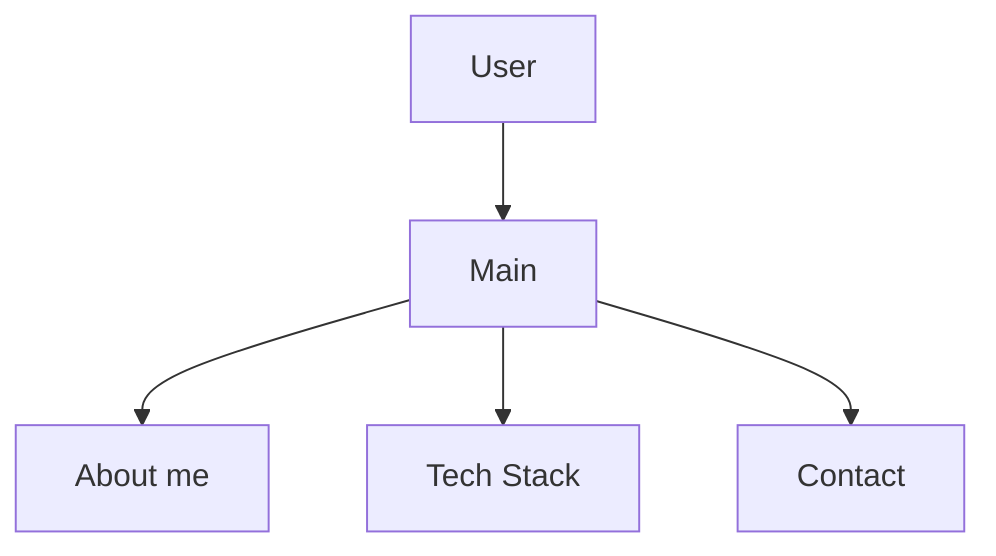

# Portfolio


## Tabla de contenido 

-	[Instalacion](#instalacion)
-	[Hoja de ruta](#hoja-de-ruta)
-	[Ejemplo de codigo](#ejemplo-de-codigo)
-	[Arquitectura](#arquitectura)
-	[Contribucion](#contribucion)
-	[Licencia](#licencia) 
-	[Autor](#autor) 

## Instalacion


```bash
git clone https://github.com/TU-USUARIO/portfolio cd portfolio
```

## Hoja de ruta
- [x] Estructurado de página
- [x] Estilo de página
- [ ] Automatizaciones 
- [ ] Creación de Base de Datos


## Ejemplo de codigo:

```html
<!-- TECH STACK -->
    <section id="tech-stack">
      <div class="wrap">
        <h2>Tech stack</h2>
        <div class="stack">
          <article class="tech html">
            <div class="badge">H5</div>
            <h3>HTML5</h3>
            <p>Estructura semántica, formularios y buena accesibilidad.</p>
          </article>
          <article class="tech css">
            <div class="badge">C3</div>
            <h3>CSS3</h3>
            <p>Flexbox, Grid, variables y diseño responsive.</p>
          </article>
          <article class="tech js">
            <div class="badge">JS</div>
            <h3>JavaScript</h3>
            <p>Interacción en el navegador y manejo del DOM.</p>
          </article>
          <article class="tech git">
            <div class="badge">Git</div>
            <h3>Git y GitHub</h3>
            <p>Control de versiones y trabajo en equipo.</p>
          </article>
        </div>
      </div>
    </section>


```
## Arquitectura


## Contribucion

Lee la [guia de contribucion](CONTRIBUTING.md) antes de enviar cambios.

## Licencia
Este proyecto usa la licencia MIT. Revisa el archivo [LICENSE](LICENSE). 

## Autor
Hecho por **Diana Cordova** - [GitHub](https://github.com/leydecordova-rgb)